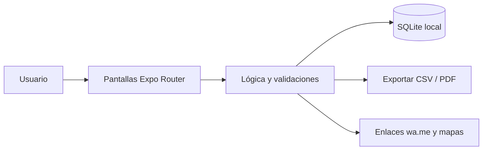

<div align="center">


# RecetaCosto

**Costeo de recetas para panaderías, pastelerías y cocinas: costo por porción, merma y precio de venta sugerido.**

[](LICENSE)
[](https://github.com/LuisRocha2080/RecetaCosto/actions/workflows/ci.yml)


[Vista rápida](#vista-rápida) · [Características](#características) · [Stack](#stack) · [Roadmap](#roadmap) · [Modelo comercial](#modelo-comercial) · [Inicio rápido](#inicio-rápido) · [Contribuir](#contribuir)

</div>

---

## Vista rápida

| | |
|---|---|
| **Para quién** | Panaderías, pastelerías, cafeterías, salteñerías y emprendimientos de comida casera |
| **Problema** | Los insumos suben de precio cada semana y el dueño sigue vendiendo al mismo precio: no sabe cuánto le cuesta realmente cada producto ni qué margen deja. |
| **Solución** | App móvil que funciona sin internet y guarda todo en el teléfono. |
| **Costo de licencias** | Bs 0: Expo, React Native, SQLite y TypeScript son de código abierto. |

## Características

- Ingredientes con precio de compra, unidad y porcentaje de merma.
- Recetas con cantidades y número de porciones.
- Costo por porción que se recalcula solo cuando cambia un ingrediente.
- Precio de venta sugerido según el margen objetivo.
- Escalado de recetas (de 12 a 120 unidades) y lista de compras de la producción.
- Ficha técnica en PDF y alerta cuando el margen cae bajo el objetivo.

Sin servidores, sin suscripciones obligatorias y sin servicios de pago: todos los datos viven en el dispositivo (SQLite).

## Stack

| Capa | Tecnología |
|---|---|
| App | React Native + Expo (TypeScript) |
| Datos | SQLite local (`expo-sqlite`) |
| Navegación | Expo Router |
| Pruebas | Jest + `tsc --noEmit` |
| Distribución | APK directo / EAS Build local |

### Modelo de datos

- `ingredientes` (id, nombre, unidad, precio_compra, cantidad_compra, merma_pct, actualizado_en)
- `recetas` (id, nombre, porciones, margen_objetivo_pct, precio_venta_actual, notas)
- `receta_items` (id, receta_id, ingrediente_id, cantidad)
- `historial_precios` (id, ingrediente_id, fecha, precio_unitario)

Detalle completo: [docs/DATOS.md](docs/DATOS.md).

## Arquitectura



## Roadmap

1. Base y navegación
2. Ingredientes
3. Recetas y costo
4. Producción y alertas
5. Ficha y piloto

Detalle fase por fase: [docs/ROADMAP.md](docs/ROADMAP.md) · [docs/SPEC.md](docs/SPEC.md) · [docs/PLANNING.md](docs/PLANNING.md) · [docs/DATOS.md](docs/DATOS.md) · [docs/PANTALLAS.md](docs/PANTALLAS.md) · [docs/PRUEBAS.md](docs/PRUEBAS.md) · [docs/BACKLOG.md](docs/BACKLOG.md) · [docs/NEGOCIO.md](docs/NEGOCIO.md)

## Modelo comercial

- **Cómo se vende:** Pago único por negocio o plan anual con soporte de configuración inicial.
- **Precio de partida:** Hipótesis a validar: Bs 120–200 pago único.
- **Canal:** Panaderías y pastelerías del barrio, cursos de repostería y grupos de emprendedores de comida.
- **Piloto:** 5 negocios por 30 días, midiendo cuántos ajustan algún precio de venta tras ver su margen.

Los precios son hipótesis para validar con clientes reales antes de fijarlos. Ver [docs/NEGOCIO.md](docs/NEGOCIO.md).

## Estructura

```
RecetaCosto/
├── app/            # Pantallas y rutas (Expo Router)
├── src/
│   ├── db/         # Esquema y consultas SQLite
│   ├── components/ # Componentes reutilizables
│   └── lib/        # Utilidades
├── docs/           # Roadmap, specs, planificación, datos, pantallas, pruebas, backlog
└── .github/        # Plantillas, CI y Dependabot
```

## Inicio rápido

Requisitos: Node.js 20+ y la app Expo Go (o un emulador).

```bash
git clone https://github.com/LuisRocha2080/RecetaCosto.git
cd RecetaCosto
npm install
npx expo start
```

> El repositorio está en **fase inicial**: la documentación y la estructura están listas y el código de la app se construye siguiendo el [roadmap](docs/ROADMAP.md).

## Pruebas

```bash
npm test
npx tsc --noEmit
```

## Seguridad

Los datos no salen del teléfono. Para reportar una vulnerabilidad lee [SECURITY.md](SECURITY.md).

## Lo que todavía no existe

- Los costos indirectos (gas, luz, alquiler) se ingresan manualmente en la primera versión.
- No gestiona inventario de insumos.
- El precio sugerido es una referencia: no reemplaza el estudio de mercado.

## Contribuir

Lee la [guía de contribución](CONTRIBUTING.md) y el [código de conducta](CODE_OF_CONDUCT.md). Para dudas, consulta [SUPPORT.md](SUPPORT.md).

## Licencia

Distribuido bajo licencia MIT. Consulta [LICENSE](LICENSE).

---

<div align="center">Hecho por <a href="https://github.com/LuisRocha2080">LuisRocha2080</a></div>
